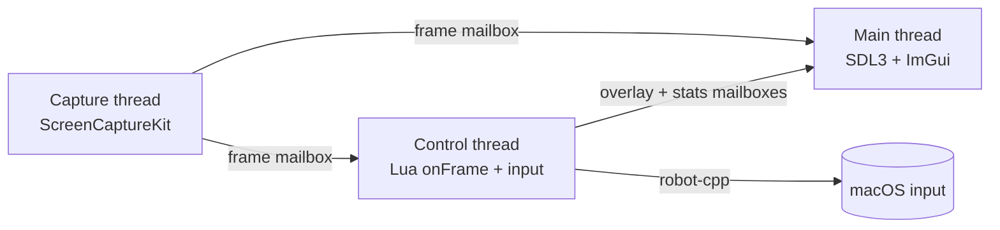

# 🤖 Automation Engine

A macOS desktop-automation engine: pick a window, stream it into an ImGui debug UI, and drive keyboard/mouse from Lua scripts that run against every captured frame. This is the v2 rewrite of the original 2021-2023 engine (see the `master` branch); the long-term goal is vision-driven automation (YOLO object detection, local LLM assistance) with end-to-end latency low enough for real-time game control.

## Why the rewrite

The original engine was a first C++ project built on a tutorial-grade custom ECS, singletons, and ad-hoc threading. The rewrite keeps what proved out - the Lua/sol2 scripting model with TypeScript typings, the overlay-debugging workflow - and replaces the implementation with the architecture used by its sibling libraries ([robot-cpp](https://github.com/developer239/robot-cpp), [llame-worker](https://github.com/developer239/llame-worker)): C++23, `std::expected` for every fallible operation, explicit ownership from a single composition root, and no global state.

## Architecture

Three free-running stages connected by single-slot latest-value mailboxes. Frames are dropped, never queued - for automation, a stale frame is worse than a missing one.



- **Capture thread** (ScreenCaptureKit's dispatch queue): retains each frame's `CVPixelBuffer` into an RAII handle and swaps it into the frame mailbox. No conversion, no copies.
- **Control thread**: exclusively owns the Lua state and all input injection. Sleeps on the frame mailbox, runs the script's `onFrame` once per frame sequence number, and publishes the overlay command buffer and stats. All safety transitions happen here: held keys and buttons are released on pause, script reload/error, focus loss, target change, and shutdown.
- **Main thread**: SDL3 + ImGui docking shell. A pure observer - it polls the mailboxes, uploads the latest frame to a streaming texture, and draws overlays on top. It talks to the control thread only through a command queue.

Input scripts issue coordinates in capture pixel space; the engine converts to global desktop coordinates using the frame's ScreenCaptureKit scale metadata and the window's bounds re-read at injection time. Input is refused with a typed error (never a silent no-op) when the target window is not frontmost, the frame is stale, or coordinates fall outside the frame.

```
src/
├── main.cpp        composition root: owns every object, wires the pipeline
├── capture/        SCK window enumeration + capture stream, CG window/focus queries
├── control/        control thread, command queue, robot-cpp input controller
├── pipeline/       mailbox primitive, overlay/stats snapshot types
├── scripting/      Lua runtime (sol2), script-facing API bindings
└── ui/             SDL3 + ImGui shell, log ring sink
```

## Dependencies

All vendored as git submodules except SDL3.

| Dependency | Version | Role |
| --- | --- | --- |
| [robot-cpp](https://github.com/developer239/robot-cpp) | main | Keyboard/mouse injection, coordinate spaces |
| [Lua](https://github.com/lua/lua) | v5.4.8 | Script runtime |
| [sol2](https://github.com/ThePhD/sol2) | develop | Lua bindings (develop branch: v3.3.1 does not compile on current Clang) |
| [Dear ImGui](https://github.com/ocornut/imgui) | v1.92.9 docking | Debug UI |
| [spdlog](https://github.com/gabime/spdlog) | v1.17.0 | Logging (stdout + in-app ring buffer) |
| SDL3 (Homebrew) | 3.x | Window, renderer, input events |

## Build

Requirements: macOS 14+, Xcode command line tools, CMake 3.24+, Ninja, SDL3.

```bash
brew install cmake ninja sdl3
git clone --recursive <repo-url>
cmake -S . -B build -G Ninja -DCMAKE_BUILD_TYPE=Release
cmake --build build -j
./build/src/automation-engine
```

Set `SPDLOG_LEVEL=debug` for verbose logging.

### Permissions

Grant these to your terminal (or IDE) in System Settings > Privacy & Security, then restart it:

- **Screen Recording** - window enumeration and capture. Without it the Windows panel reports a permission error.
- **Accessibility** - keyboard/mouse injection. Without it the app still runs and streams, but every `input.*` call returns an error.

## Scripting

Pick a window in the **Windows** panel, then load a script in the **Script** panel (start with [`scripts/example.lua`](scripts/example.lua)). The script defines a `main` table; `onFrame` runs once per captured frame on the control thread:

```lua
main = {
  onFrame = function(frame)
    -- frame: seq, width, height, ageMs, deltaMs, isFocused
    overlay.box({ x = 100, y = 100, w = 50, h = 50, color = { r = 255, g = 0, b = 0 } })

    local ok, err = input.click(125, 125)
    if not ok then
      log.warn(err.code .. ": " .. err.message)
    end
  end,
}
```

Every `input.*` and `overlay.*` call returns `true` on success or `nil, { code, message }` on refusal. Scripts can also be written in TypeScript via [TypeScriptToLua](https://typescripttolua.github.io/) using the type definitions in [`automation-engine.d.ts`](automation-engine.d.ts).

| Global | Functions |
| --- | --- |
| `overlay` | `box{x,y,w,h,color?,thickness?,filled?}`, `line{x1,y1,x2,y2,color?,thickness?}`, `text{x,y,text,color?}` - capture pixel space, cleared every frame |
| `input` | `move(x,y)`, `moveSmooth(x,y)`, `click(x,y,button?)`, `pressButton(b)`, `releaseButton(b)`, `tap(key)`, `press(key)`, `release(key)`, `typeText(s)` |
| `target` | `focus()` - bring the captured window's app to the foreground |
| `log` | `info(s)`, `warn(s)`, `error(s)` - land in the Logs panel and stdout |
| `keys` | validated key-name constants (`keys.W`, `keys.SPACE`, ...) |

Rules the engine enforces:

- Input and overlay calls are only legal inside `onFrame`.
- Input is refused while the target window is not frontmost (toggleable in the Script panel), when the frame is older than 250 ms, or when coordinates fall outside the frame.
- A script error releases all held input and pauses the script until you reload or unpause.
- A tick that runs longer than 100 ms is aborted (runaway-loop protection).
- Colors are `{ r, g, b, a }` in 0-255; alpha defaults to 255.

## Roadmap

- **Vision** - standalone YOLO/ONNX Runtime detection library (shaped like llame-worker), a vision stage between capture and control, detections delivered to `onFrame`.
- **LLM** - [llame-worker](https://github.com/developer239/llame-worker) integration as an async advisory worker, never on the control path.
- **Window capture in robot-cpp** - `src/capture/` is engine-internal until robot-cpp's planned ScreenCaptureKit migration lands, then it graduates there.
